<!-- readme-standard: 2026-11-02 -->
<div align="center">



# TradeZella → SmartTraderAI (STB) Import Tool


 **You are here:** drasticstatic lab › `TradeZella_STB` · public · `main` is the working branch

</div>

##  TL;DR

1.  **What this is.** A Python script that converts a TradeZella CSV export into the STB Bulk Import format, writing straight to your Google Sheet (or `.xlsx` if credentials are not set up).
2.  **Who it is for.** Traders on Mac or Windows who use TradeZella and SmartTraderAI.
3.  **Do this first.** Follow [Step 0](#-step-0--create-your-working-folder), or [watch the demo](https://youtu.be/3Cjl0XHMwXM).

Automates converting a TradeZella CSV export into the STB Bulk Import format.
**Default behavior: writes directly to your Google Sheet.**
Falls back to `.xlsx` if Google credentials are not yet configured.

> **Note on TradeZella export filenames:** TradeZella names exports using a
> timestamp, e.g. `trades_20260218124033.csv`. The script accepts any
> `trades_*.csv` filename — no renaming needed before running it.

Watch the Demo Video: [View on YouTube](https://youtu.be/3Cjl0XHMwXM)
<video src="Screen Recording 2026-02-18 at 05.15.56.mov" controls width="600"></video>

[or Download the Screen Recording here](https://github.com/drasticstatic/TradeZella_STB/blob/main/Screen%20Recording%202026-02-18%20at%2005.15.56.mov)
Note: GitHub's web preview restricts "raw" embedded local video for security and performance reasons, whereas VS Code allows them because it runs in a local environment.
To view the demo, please click the links to download/open the video file directly, or view this readme in a Markdown-capable editor like VS Code.

---

## 📁 Files in This Package

| File | Purpose |
|---|---|
| `tradezella_to_stb.py` | Core Python script — works on Windows & Mac |
| `automator_drop_handler.sh` | macOS Automator drag-and-drop app script |
| `STB_Import_Template.xlsx` | STB import template — keep in same folder |
| `service_account.json` | *(you create this)* Google Cloud credentials |

---

## 📂 Step 0 — Create Your Working Folder

> **Optional but recommended.** Keeps all files in one place.
> If you prefer to organise files your own way, just make sure
> `tradezella_to_stb.py`, `STB_Import_Template.xlsx`, and
> `service_account.json` are always in the same folder.

### 🍎 Mac

Open **Terminal** (Spotlight → type "Terminal" → Enter) and run:

```bash
mkdir -p ~/TradeZella_STB
```

Move your downloaded files in:

```bash
mv ~/Downloads/tradezella_to_stb.py ~/TradeZella_STB/
mv ~/Downloads/automator_drop_handler.sh ~/TradeZella_STB/
mv ~/Downloads/STB_Import_Template.xlsx ~/TradeZella_STB/
```

Verify everything is there:

```bash
ls ~/TradeZella_STB/
```

---

### 🪟 Windows

Open **Command Prompt** (`Windows + R` → type `cmd` → Enter):

```
mkdir %USERPROFILE%\TradeZella_STB
```

Move files in (or drag them in File Explorer):

```
move %USERPROFILE%\Downloads\tradezella_to_stb.py ^
     %USERPROFILE%\TradeZella_STB\
move %USERPROFILE%\Downloads\STB_Import_Template.xlsx ^
     %USERPROFILE%\TradeZella_STB\
```

Verify:

```
dir %USERPROFILE%\TradeZella_STB\
```

---

## 🐍 Install Python Packages — One Time Only

These four packages are required. The install method differs slightly
depending on your setup.

### 🍎 Mac — Using a Virtual Environment (Recommended)

Modern macOS with Homebrew protects the system Python from global
package installs. The solution is a **virtual environment** — a
self-contained Python space just for this project. You only do this once.

```bash
cd ~/TradeZella_STB
python3 -m venv venv
source venv/bin/activate
pip install pandas openpyxl gspread google-auth
```

Your terminal prompt will show `(venv)` when the environment is active.

**Every time you open a new Terminal window** to run the script manually,
reactivate it first:

```bash
cd ~/TradeZella_STB
source venv/bin/activate
```

> The Automator app handles this automatically — you never need to
> activate the venv manually when using drag-and-drop.

---

### 🍎 Mac — Using Homebrew (Recommended if you have Homebrew)

Since Homebrew manages its own Python environment, use the
`--break-system-packages --user` flags to install safely into
your home directory:

```bash
pip3 install pandas openpyxl gspread google-auth \
  --break-system-packages --user
```

> **Note on PATH warnings:** You may see warnings that scripts were
> installed to `/Users/yourname/Library/Python/3.x/bin` which is not
> on PATH. These are safe to ignore — the packages themselves are
> installed correctly and the script will work fine.

---

### 🪟 Windows

```
pip install pandas openpyxl gspread google-auth
```

If `pip` is not found, use:

```
python -m pip install pandas openpyxl gspread google-auth
```

---

## ☁️ Google Sheets Setup — One Time Only

This lets the script push trades directly into your live Google Sheet.

Google Sheet Template:
https://docs.google.com/spreadsheets/d/1SonfR5bUHj_xXqJpSQ6ajpkSi2lV0zdP5z7GBEbyMzs/edit?usp=sharing

### Step 1 — Create a Google Cloud Project

1. Go to [console.cloud.google.com](https://console.cloud.google.com/)
2. Click the project dropdown → **"New Project"**
3. Name it (e.g. `TradeZella STB`) → **Create**

### Step 2 — Enable the APIs

1. Left sidebar → **"APIs & Services"** → **"Library"**
2. Search **"Google Sheets API"** → **Enable**
3. Search **"Google Drive API"** → **Enable**

### Step 3 — Create a Service Account

1. Left sidebar → **"APIs & Services"** → **"Credentials"**
2. **"+ Create Credentials"** → **"Service Account"**
3. Name it (e.g. `stb-importer`) → **Create and Continue** → **Done**
4. Click the service account → **"Keys"** tab
5. **"Add Key"** → **"Create new key"** → **JSON** → **Create**
6. Rename the downloaded file to `service_account.json`
7. Move it into your working folder:

**Mac:**
```bash
mv ~/Downloads/service_account.json ~/TradeZella_STB/
```

**Windows:**
```
move %USERPROFILE%\Downloads\service_account.json ^
     %USERPROFILE%\TradeZella_STB\
```

### Step 4 — Share Your Google Sheet

1. Open `service_account.json` in any text editor
2. Copy the `"client_email"` value
   (looks like `stb-importer@your-project.iam.gserviceaccount.com`)
3. Open your STB Google Sheet → **Share**
4. Paste the email → role **Editor** → **Send**

### Step 5 — Add Your Spreadsheet ID

1. Copy the ID from your Google Sheet URL:
   `https://docs.google.com/spreadsheets/d/`**`YOUR_ID_HERE`**`/edit`
2. Open `tradezella_to_stb.py` in any text editor
3. Find this line near the top:
   ```python
   SPREADSHEET_ID = "YOUR_SPREADSHEET_ID_HERE"
   ```
4. Replace `YOUR_SPREADSHEET_ID_HERE` with your actual ID (keep the quotes)

---

## 🪟 Windows — Daily Use

1. Export trades from TradeZella as `.csv` (any filename is fine)
2. Open Command Prompt in your folder
   *(File Explorer → click address bar → type `cmd` → Enter)*
3. Run:
   ```
   python tradezella_to_stb.py trades_20260218124033.csv
   ```
   - **Google Sheets configured** → trades append to your live sheet ✅
   - **Not yet configured** → `STB_Import_Merged_YYYYMMDD.xlsx` is
     created in the same folder — upload it manually

### Optional flags

| Flag | What it does |
|---|---|
| `--sheets` | Force Google Sheets output |
| `--xlsx` | Force .xlsx file output |
| `--sheet-id YOUR_ID` | Override spreadsheet ID without editing script |
| `--tab "Sheet1"` | Specify a different tab name |
| `--output myfile.xlsx` | Custom output filename (xlsx mode) |

### Optional: One-click `.bat` launcher

Create `run_merge.bat` in your folder:

```bat
@echo off
cd /d "%~dp0"
python tradezella_to_stb.py %1
pause
```

Drag any CSV onto `run_merge.bat` to run without opening Command Prompt.

---

## 🍎 Mac — Daily Use

The **recommended method** is the Automator app — a desktop icon
you drag CSV files onto. No Terminal needed after setup.

### Method 1: Automator Drag-and-Drop ⭐ Recommended

**One-time setup (~5 minutes):**

1. Confirm `~/TradeZella_STB/` contains:
   - `tradezella_to_stb.py`
   - `STB_Import_Template.xlsx`
   - `service_account.json` *(after Google Cloud setup)*
   - `venv/` folder *(after Python package install)*

2. Open **Automator**
   *(Spotlight → "Automator" → Enter)*

3. Choose **"Application"** as the document type

4. Search for **"Run Shell Script"** → drag it into the workflow

5. Set **"Pass input:"** to **`as arguments`**
   *(critical — this is how the CSV path reaches the script)*

6. Delete all default code in the text box

7. Paste the entire contents of `automator_drop_handler.sh`

8. **File → Save** → name it `TradeZella to STB` → save to **Desktop**

**Daily use:**

1. Export trades from TradeZella as `.csv`
2. Drag the `.csv` onto **TradeZella to STB** on your Desktop
3. Result:
   - Google Sheets configured → trades appear in your sheet ✅
   - Not configured → `.xlsx` file saved next to your CSV and
     opens automatically ✅

You can drop multiple CSV files at once.

---

### Method 2: Terminal

```bash
cd ~/TradeZella_STB
source venv/bin/activate
python3 tradezella_to_stb.py ~/Downloads/trades_20260218124033.csv
```

---

## 📋 Column Mapping Reference

| TradeZella | → | STB Template | Notes |
|---|---|---|---|
| Open Date | → | Trading Date | |
| Entry Model | → | Entry Model | Blank → `other (specify)` |
| *(hardcoded)* | → | Currency | Always `USD` |
| Net P&L | → | Profit / Loss | |
| Status + Net P&L | → | Outcome | `green` / `red` / `breakeven` |
| Emotions | → | Emotions | Multi-select, passed through as-is |
| Did Emotions Affect Decisions? | → | Did emotions affect decisions? | yes / no |
| Was Emotionally Stable? | → | Was emotionally stable? | yes / no |
| Profit Target Did You Respect It? | → | Profit target - did you respect it? | |
| Stop Loss Did You Respect It? | → | Stop loss - did you respect it? | |
| Entry Logic Explanation | → | Entry logic explanation | |
| How Did The Trade Play Out? | → | How did the trade play out? | |
| Notes For Coaches | → | Notes for coaches | |
| *(not in TradeZella)* | → | Screenshot URLs | Left blank |

---

## 🆘 Troubleshooting

| Problem | Fix |
|---|---|
| `ModuleNotFoundError: pandas` | Run the venv setup steps in the Python install section |
| `externally-managed-environment` | Use the virtual environment method — see Python install section |
| `SPREADSHEET_ID is not set` | Edit `SPREADSHEET_ID` at the top of `tradezella_to_stb.py` |
| `service_account.json not found` | Move it into the same folder as the script |
| `403 PERMISSION_DENIED` | Share the Google Sheet with the `client_email` from your JSON (Editor) |
| `gspread.exceptions.APIError` | Enable both Sheets API and Drive API in Google Cloud Console |
| Automator does nothing | Check **"Pass input: as arguments"** is set in the workflow |
| Automator can't find Python | Run `which python3` in Terminal and update `SCRIPT_DIR` in the Automator script |
| Python not found on Mac | Install from [python.org](https://python.org) or `brew install python3` |
| Template not found | Confirm `STB_Import_Template.xlsx` is in the same folder as the script |
# TradeZella_STB

##  Suggest a change

Noticed something? Open an [issue](../../issues) or a pull request against `main`; Christopher reads them and a person with the role merges. Not on GitHub? Reach Christopher through [his contact page](https://drasticstatic.github.io/resume/pages/contact.html).

<sub>The front door follows the living [README standard](https://github.com/drasticstatic/my-template/blob/main/README-STANDARD.md). Copy it, improve it.</sub>
